# 47 Premium Web Hosting Control Panels: Streamline Server Management, Boost Performance Efficiency!

Managing web servers efficiently requires the right control panel—a platform that simplifies complex tasks, enhances security, and scales with business needs. **Web hosting control panels** provide graphical interfaces that eliminate command-line complexity, allowing administrators to manage domains, databases, emails, and applications through intuitive dashboards. From small businesses to enterprise hosting providers, these platforms deliver automation, security features, and multi-server capabilities that transform server administration into streamlined workflows.

## **[Plesk](https://www.plesk.com)**

Comprehensive hosting control panel offering Windows and Linux support with built-in automation tools for managing websites, emails, databases, and multi-server environments across VPS and dedicated servers.

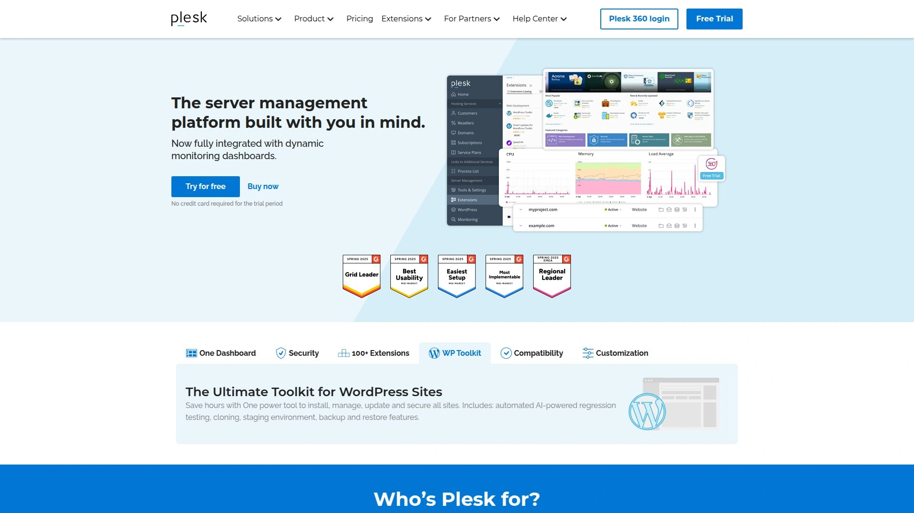

- Multi-server management with centralized control panel that oversees multiple servers and applications through a single interface, reducing website management complexity
- WordPress Toolkit integration providing staging environments, security hardening, automated backups, and one-click cloning for WordPress site management
- Enhanced security features including automatic SSL certificate acquisition, SNI protocol implementation, firewall management, and self-repair tools to minimize downtime
- Modern web stack supporting multiple PHP versions with seamless switching, NGINX caching for performance optimization, and over 100 extensions for enhanced functionality
- **Why Choose This:** Plesk excels as a versatile solution supporting both Windows and Linux environments with enterprise-grade features including centralized multi-server management, making it ideal for web hosting companies, resellers, and organizations requiring comprehensive automation. Its intuitive GUI combined with SSH access provides flexibility for both beginners and advanced users managing high-traffic websites.

## **[cPanel](https://www.cpanel.net)**

Industry-leading Linux-based control panel with WHM integration, offering extensive third-party compatibility, automated software installation through Softaculous, and comprehensive website management tools for shared, dedicated, and WordPress hosting environments.

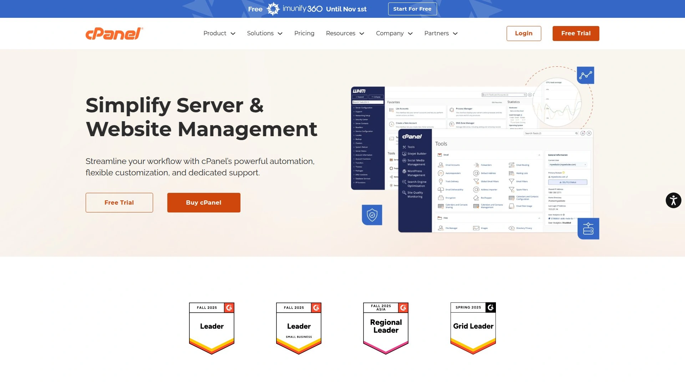

- Softaculous Apps Installer providing access to 400+ applications including popular CMS platforms with automated installation, lifecycle management, and update handling
- WHM (Web Host Manager) integration enabling server administrators to create and manage multiple cPanel accounts with granular resource allocation and reseller functionality
- Categorized interface organizing features under Files, Databases, and Software groups with drag-and-drop icon customization for personalized workflows
- **Why Choose This:** cPanel dominates the hosting control panel market with its robust feature set, extensive browser compatibility, and unmatched third-party application support. Its combination of user-friendly interface and powerful automation makes it the preferred choice for hosting providers and users seeking industry-standard reliability with comprehensive technical documentation and community support.

## **[DirectAdmin](https://www.directadmin.com)**

Fast, stable web control panel designed for ease of use, offering three-tier access levels (administrator, reseller, user) with comprehensive domain, email, database management, and cost-effective licensing for Linux and BSD systems.

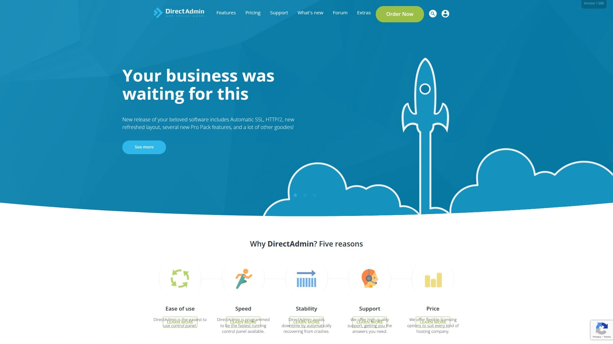

- Three-tier access system with separate interfaces for administrators, resellers, and end-users, enabling efficient account delegation and management hierarchies
- Pro-Pack features including CGroups for per-user resource limits, user-selectable NGINX templates, Redis integration, and comprehensive SSL management
- Built-in backup system with FTP upload capability, naming conventions supporting daily/weekly/monthly schedules, and full or partial restore options
- **Why Choose This:** DirectAdmin stands out for its exceptional speed and lightweight architecture, making it ideal for VPS and dedicated servers where performance efficiency matters. Its significantly lower licensing costs compared to competitors, combined with comprehensive reseller tools and straightforward interface, provide excellent value for hosting businesses and users prioritizing stability without sacrificing functionality.

## **[Webmin](https://webmin.com)**

Open-source web-based system administration tool for Unix-like servers, offering modular architecture with 110+ standard modules, remote management capabilities, and browser-based access to system configuration without command-line requirements.

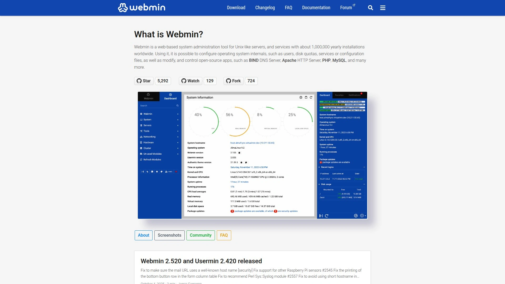

- Modular design with over 110 standard modules enabling custom plugin development and seamless addition of functionality for desktop and server configuration
- Multi-server management allowing control of multiple machines through a single interface with seamless login across same subnet or LAN systems
- Comprehensive service management for Apache, Nginx, MySQL, and other services with web-based shell for command execution directly from the interface
- **Why Choose This:** Webmin's open-source BSD license and zero-cost model make it exceptionally accessible for system administrators managing Unix-like systems. Its extensive module library combined with web-based terminal access provides flexibility for both GUI-preferring users and CLI enthusiasts, while multi-server management capabilities scale efficiently across infrastructure without licensing costs.

## **[CyberPanel](https://cyberpanel.net)**

Free open-source control panel featuring integrated OpenLiteSpeed and LiteSpeed Enterprise support, offering superior performance with built-in caching, automatic SSL via Let's Encrypt, and one-click WordPress management without installation limits.

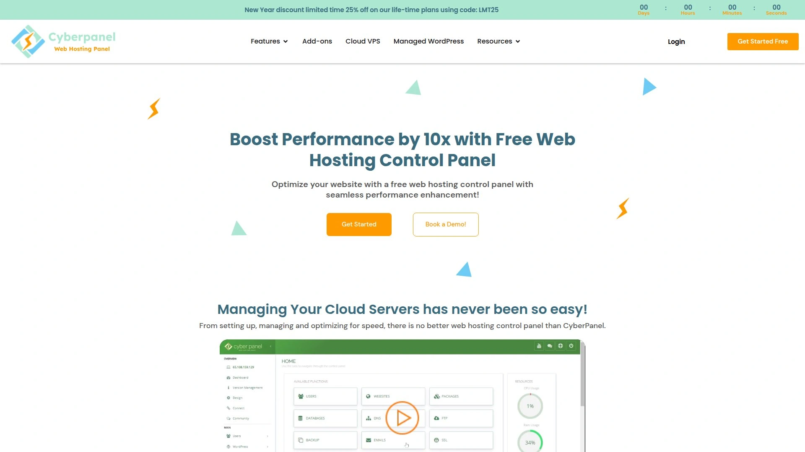

- Built-in LiteSpeed Web Server providing superior performance and security compared to Apache with integrated advanced caching and CDN for optimal website speed
- LiteSpeed Cache integration enabling page-level and server-level caching with custom configuration options specifically optimized for WordPress sites
- Automatic SSL certificate issuance via Let's Encrypt with auto-renewal enabled by default, eliminating manual certificate management
- Unlimited installations with no restrictions on number of websites or deployments in the free forever plan
- **Why Choose This:** CyberPanel revolutionizes hosting control with its built-in LiteSpeed technology delivering 10x performance improvements without licensing fees. The combination of modern interface design, automatic security features, and zero-cost unlimited installations makes it compelling for performance-focused users and hosting providers seeking cost-effective alternatives with enterprise-grade speed capabilities.

## **[ISPConfig](https://www.ispconfig.org)**

Open-source multi-server control panel supporting Apache and Nginx, offering cluster management, automated CMS deployment for WordPress/Joomla/Drupal, DNS management, and comprehensive email hosting with secure FTP support.

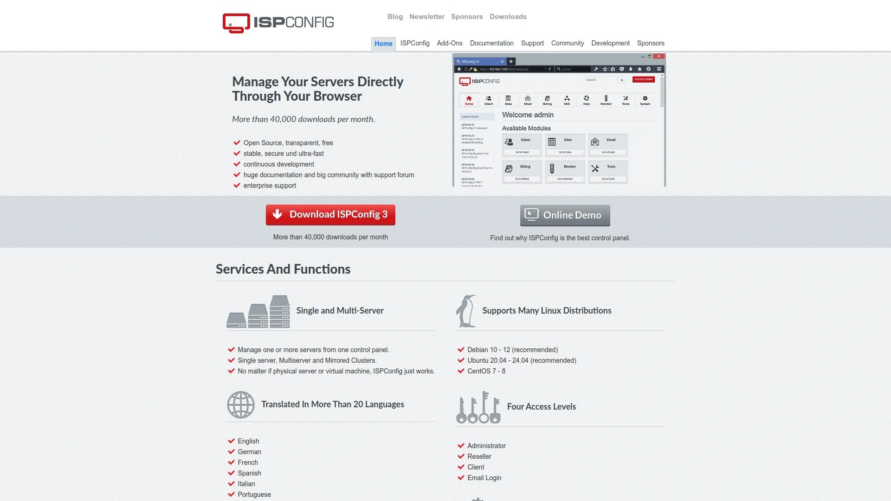

- Multi-server management with cluster capabilities allowing operation of several servers from single control panel with load balancing for improved performance and reliability
- Automated CMS installer for quick deployment of WordPress, Joomla, and Drupal platforms with tiered access levels for administrators, resellers, and clients
- Comprehensive DNS management supporting A, CNAME, MX records with reverse DNS capabilities for enhanced email deliverability
- **Why Choose This:** ISPConfig delivers enterprise-level multi-server management without licensing costs, making it ideal for hosting providers scaling infrastructure across multiple physical or virtual servers. Its comprehensive feature set including automatic Let's Encrypt SSL configuration and active community development provides professional-grade capabilities for users requiring free, robust server administration tools.

## **[Virtualmin](https://www.virtualmin.com)**

Web hosting control panel based on Webmin, available in GPL (free) and Professional versions, providing advanced access control, resource limits enforcement, cloud DNS integration, and migration tools from cPanel/Plesk/DirectAdmin platforms.

- Resource limits functionality defining CPU and memory constraints for virtual servers and sub-servers, preventing system overload from fork bombs or excessive RAM usage
- Cloud DNS providers integration supporting Cloudflare DNS, Google Cloud DNS, and Amazon Route 53 for higher availability and faster DNS lookups
- Comprehensive migration tools facilitating transfers from Plesk, cPanel, and DirectAdmin with backup and restore features for data safeguarding
- **Why Choose This:** Virtualmin combines Webmin's powerful system administration foundation with specialized hosting features, offering dual licensing models (free GPL and Professional) to match budget requirements. Its advanced resource limiting and external connectivity checking make it particularly valuable for resellers and administrators managing multiple virtual servers requiring granular control and automated monitoring.

## **[Control Web Panel (CWP)](https://control-webpanel.com)**

Community-driven web hosting panel for dedicated servers and VPS, offering free and Pro versions with modern interface, enhanced security, full process automation, server log visualization, and monitoring tools for Linux systems.

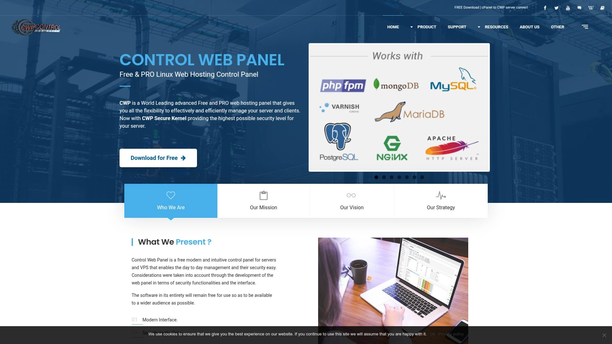

- Modern intuitive user interface with full automation of server management processes reducing manual configuration requirements
- Enhanced security features with server monitoring tools and automated log visualization for real-time system health tracking
- One-click installer, automated backups, and DNS management with active community support and documentation
- **Why Choose This:** CWP provides cost-effective server management with its free version offering substantial functionality for Linux VPS and dedicated servers. The active community support combined with comprehensive automation features makes it suitable for users transitioning from command-line management who need reliable tools without premium licensing costs.

## **[Cloudways](https://www.cloudways.com)**

Managed cloud hosting platform simplifying development, monitoring, and management of web applications without infrastructure complexity, providing intuitive interfaces for deploying applications on major cloud providers.

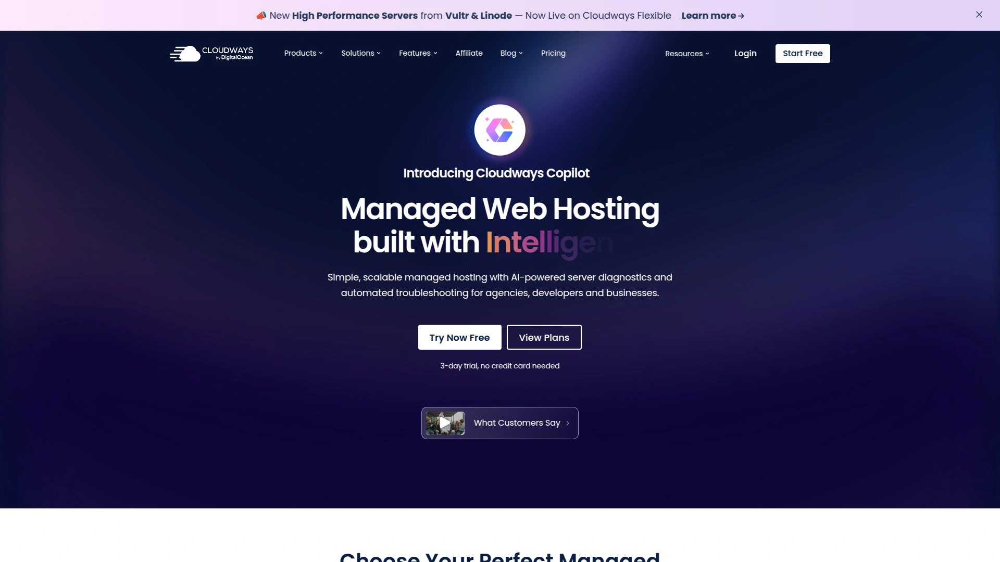

- Streamlined cloud infrastructure management eliminating complexity of direct cloud server configuration and maintenance
- **Why Choose This:** Cloudways bridges the gap between raw cloud infrastructure and user-friendly hosting management, ideal for developers and agencies requiring cloud scalability without DevOps expertise while maintaining control over application deployment and monitoring.

## **[SiteGround](https://www.siteground.com)**

Web hosting platform emphasizing speed technologies, security solutions, and technical support excellence, recognized as leading Plesk alternative with comprehensive hosting features.

- Latest speed technologies and unique security solutions integrated into hosting infrastructure
- **Why Choose This:** SiteGround combines performance-focused hosting with award-winning technical support, suitable for users prioritizing speed optimization and security without managing control panel complexity directly.

## **[Hostinger](https://www.hostinger.com)**

Web hosting provider delivering drag-and-drop website builder and application installer tools, ensuring quick website deployment with all necessary tools for fully-functional sites.

- Convenient drag-and-drop website builder simplifying site creation without coding knowledge
- **Why Choose This:** Hostinger excels in providing beginner-friendly hosting solutions with intuitive builders and installers, perfect for users seeking rapid website deployment with minimal technical barriers and affordable pricing structures.

## **[DigitalOcean](https://www.digitalocean.com)**

Cloud infrastructure platform providing intuitive interfaces and features for managing virtual servers in the cloud, offering straightforward web infrastructure building tools.

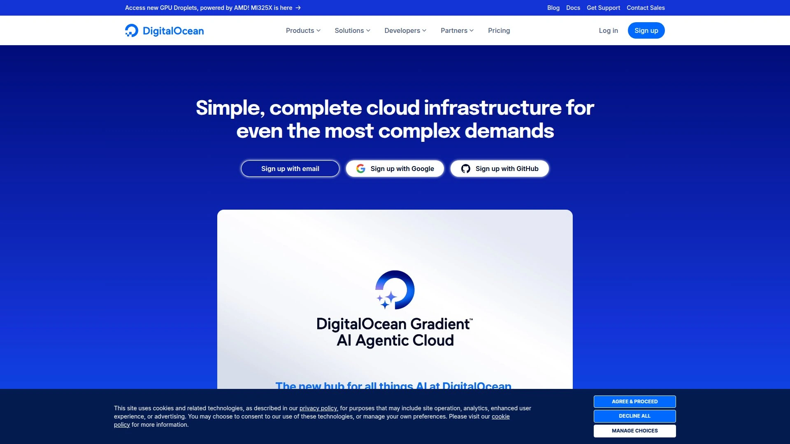

- Intuitive interface for cloud server control with comprehensive developer-focused tools
- **Why Choose This:** DigitalOcean delivers developer-centric cloud infrastructure with transparent pricing and extensive documentation, ideal for technical users requiring flexible virtual server management with scalable resources.

## **[CloudPanel](https://www.cloudpanel.io)**

Free web hosting control panel supporting multiple PHP versions, MySQL database integration, and security features including two-factor authentication, IP/Bot blocker, and SSL/TLS certificates with resource consumption analytics.

- Multiple PHP version support with seamless MySQL integration and strong security measures
- Analytics dashboard providing insights on resource consumption, CPU utilization, and load average for optimization decisions
- **Why Choose This:** CloudPanel stands out for its versatility and user-friendly interface while remaining completely free, making it ideal for individuals and small businesses seeking powerful server management without licensing costs while maintaining professional-grade security and performance monitoring capabilities.

## **[Ajenti](https://www.ajenti.org)**

Open-source control panel with built-in functions for managing different server types and tasks, offering customizable interface with plugin support and multi-language availability as free Plesk alternative.

- Built-in functions for managing domain names, email systems, FTP, and databases across various server types
- Multi-language support ensuring worldwide accessibility in users' preferred languages
- **Why Choose This:** Ajenti provides open-source flexibility with customizable interfaces suitable for users managing diverse server types who value free software with plugin extensibility, though it may be better suited for lower-traffic sites rather than high-volume eCommerce applications.

## **[Sentora](http://sentora.org)**

Free open-source web hosting control panel designed for small to medium-scale hosting environments, offering basic website, email, and database management capabilities.

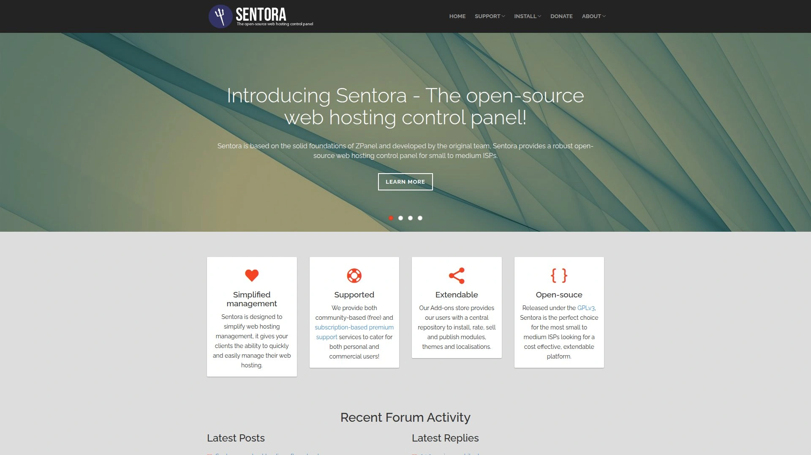

- Basic hosting management features covering essential website administration tasks
- **Why Choose This:** Sentora serves small-scale hosting needs with straightforward interfaces perfect for users operating personal websites or small business hosting environments seeking zero-cost management solutions without enterprise complexity.

## **[Froxlor](https://froxlor.org)**

Lightweight open-source server management panel for Linux systems, focusing on simplicity and efficiency for managing web hosting services with minimal resource overhead.

- Minimal resource consumption with efficient server management capabilities
- **Why Choose This:** Froxlor appeals to users prioritizing lightweight solutions for resource-constrained servers, offering essential hosting management features without bloating system resources, ideal for VPS environments with limited RAM and CPU allocations.

## **[I-MSCP](https://i-mscp.net)**

Internet Multi-Server Control Panel providing web hosting automation for shared and dedicated hosting environments with comprehensive feature sets.

- Multi-server control capabilities with automation features for hosting management
- **Why Choose This:** I-MSCP suits hosting providers requiring multi-server automation with comprehensive control features, delivering professional-grade hosting management for environments spanning multiple physical or virtual servers.

## **[TinyCP](https://tinycp.com)**

Minimalist control panel emphasizing small footprint and essential features, designed for users seeking basic server management without feature bloat.

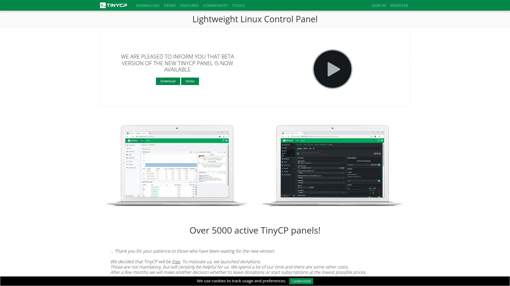

- Minimal resource footprint with focus on essential control panel functionalities
- **Why Choose This:** TinyCP targets users valuing simplicity and minimal resource usage over extensive feature sets, perfect for lightweight VPS hosting or development environments where overhead must be minimized.

## **[Vesta Control Panel](https://vestacp.com)**

Free web hosting control panel for Linux providing website, email, database, and DNS management with clean interface and straightforward configuration.

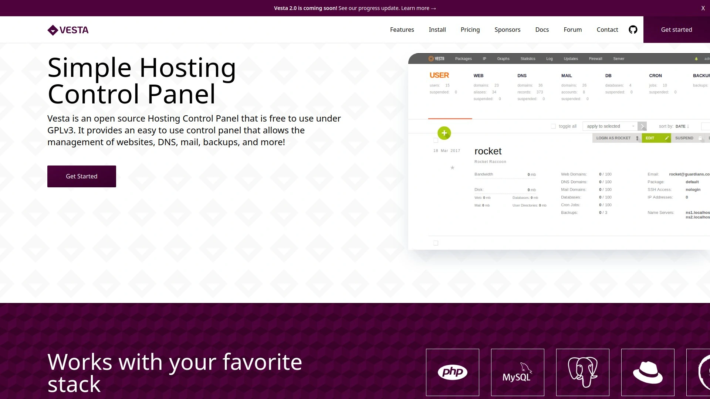

- Clean interface with comprehensive website, email, database, and DNS management tools
- **Why Choose This:** Vesta Control Panel delivers solid hosting management capabilities without licensing costs, suitable for administrators seeking reliable open-source alternatives with proven stability for Linux server environments.

## **[ServerPilot](https://serverpilot.io)**

Cloud-based server management platform focusing on optimizing PHP applications with automated security updates and performance monitoring.

- Automated security updates with PHP application optimization features
- **Why Choose This:** ServerPilot excels in PHP application hosting with automated maintenance and security patching, ideal for developers running PHP-based applications who prefer hands-off server management with cloud-based monitoring.

## **[RunCloud](https://runcloud.io)**

Modern cloud server management panel supporting multiple cloud providers with streamlined deployment processes and application management.

- Multi-cloud provider support with streamlined application deployment workflows
- **Why Choose This:** RunCloud bridges cloud infrastructure management with user-friendly interfaces, perfect for agencies and developers deploying applications across AWS, DigitalOcean, or Google Cloud while maintaining centralized control and monitoring.

## **[Cloudron](https://www.cloudron.io)**

Platform for self-hosting web applications with one-click app installations, automatic updates, and integrated backup solutions for cloud servers.

- One-click application installations with automatic update management and integrated backups
- **Why Choose This:** Cloudron simplifies self-hosting of popular web applications with app-store-like convenience, ideal for organizations and individuals seeking to maintain control over data while enjoying automated application lifecycle management.

## **[aaPanel](https://www.aapanel.com)**

Free open-source website control panel with 200+ version releases since 2017, installed on over 3 million servers with comprehensive website management features.

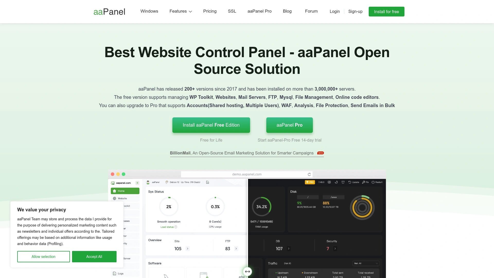

- Extensive version history with 200+ releases and proven installation base exceeding 3 million servers
- **Why Choose This:** aaPanel demonstrates reliability through its extensive deployment base and frequent updates, suitable for administrators seeking actively-developed free control panel solutions with large community support and proven stability.

## **[1Panel](https://1panel.cn)**

Open-source Linux server management panel offering modern interface with comprehensive server administration tools.

- Modern interface design with comprehensive Linux server administration capabilities
- **Why Choose This:** 1Panel provides contemporary control panel experience with open-source flexibility, appealing to administrators seeking modern interface design combined with comprehensive server management tools without proprietary restrictions.

## **[Jenkins](https://www.jenkins.io)**

Application monitoring executions of repeated jobs including software project building and cron job management with extensive automation capabilities.

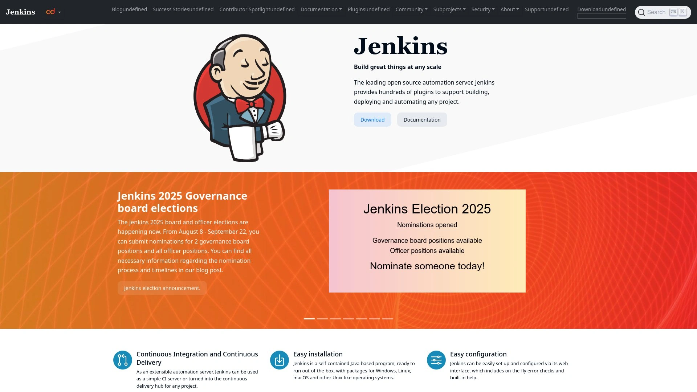

- Automated monitoring and execution of repeated jobs with software building capabilities
- **Why Choose This:** Jenkins specializes in continuous integration and deployment automation, essential for development teams requiring automated build processes and scheduled task management beyond traditional hosting control panel scope.

## **[WHM (Web Host Manager)](https://www.cpanel.net)**

Server administration interface working in tandem with cPanel, enabling hosting providers to create and manage multiple cPanel accounts with resource allocation and server configuration controls.

- Server-level administration enabling creation and management of multiple cPanel accounts with granular resource controls
- Integration with cPanel providing two-tier management structure separating server administration from individual account management
- **Why Choose This:** WHM serves hosting providers and resellers requiring server-level administrative controls above individual cPanel accounts, essential for shared hosting environments where multiple isolated customer accounts must be created and managed from centralized interface.

## **[SPanel](https://spanel.cloud)**

Control panel alternative focusing on performance and ease of use for web hosting management.

- Performance-focused design with user-friendly interface for hosting management
- **Why Choose This:** SPanel positions itself as modern cPanel alternative emphasizing speed and usability, suitable for hosting providers seeking contemporary control panel solutions with competitive pricing and performance characteristics.

## **[KeyHelp](https://www.keyhelp.de)**

Free web hosting control panel for Linux servers providing straightforward server and website management with German engineering focus.

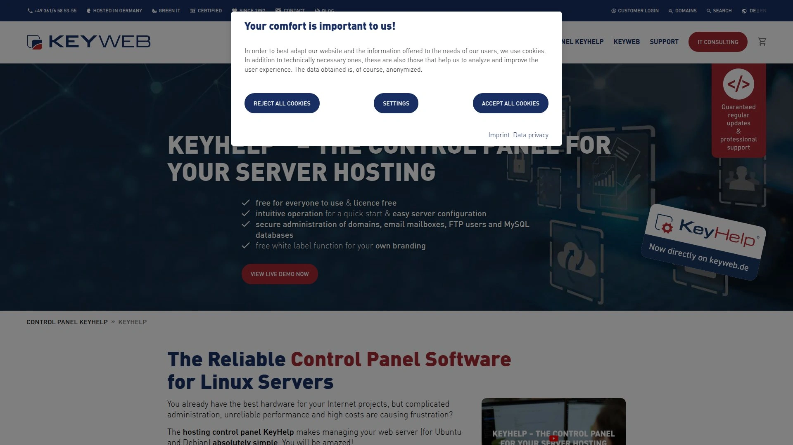

- Free licensing with comprehensive Linux server management capabilities
- **Why Choose This:** KeyHelp offers zero-cost hosting control with focus on simplicity and reliability, appealing to European users and administrators seeking free alternatives with straightforward interfaces and solid engineering principles.

## **[CentOS Web Panel (CWP)](https://centos-webpanel.com)**

Free control panel providing full server control specifically designed for CentOS systems with customizable dashboard and extensive management features.

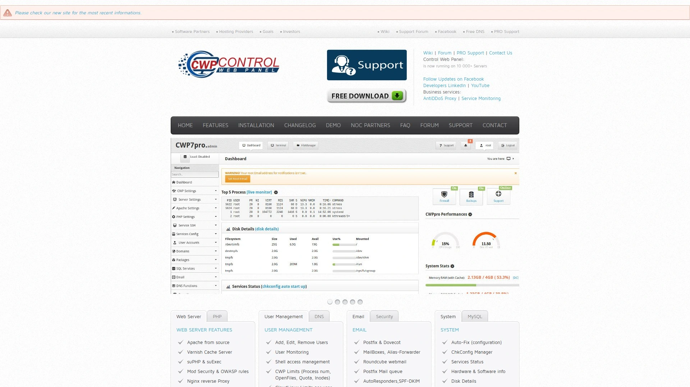

- Full server control with customizable dashboard designed specifically for CentOS Linux systems
- Free licensing with comprehensive features including DNS management and automated backups
- **Why Choose This:** CentOS Web Panel delivers specialized support for CentOS systems with zero licensing costs, ideal for administrators standardized on CentOS infrastructure seeking free comprehensive management tools with strong stability reputation.

## **[HestiaCP](https://hestiacp.com)**

Open-source web hosting control panel forked from VestaCP, providing modernized interface and active development with comprehensive hosting features.

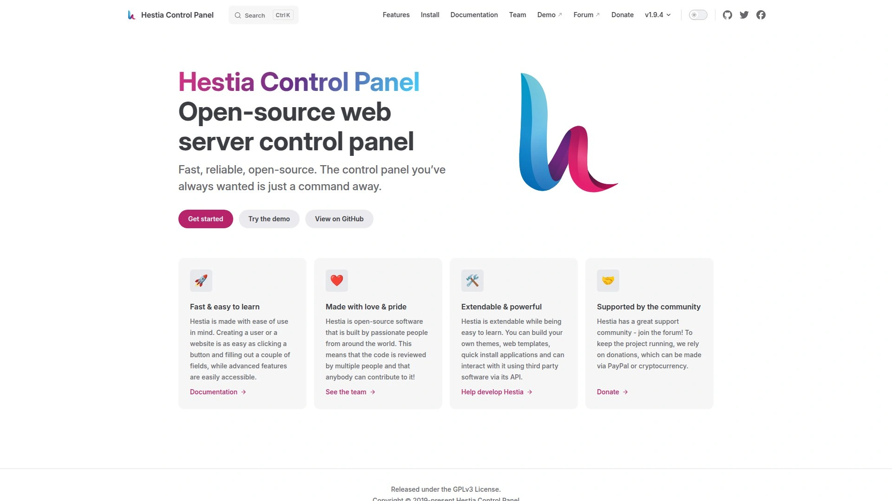

- Modern interface evolution from VestaCP with active ongoing development
- **Why Choose This:** HestiaCP continues VestaCP's legacy with renewed development momentum, suitable for users seeking modern open-source control panel with active community support and regular feature updates.

## **[FastPanel](https://fastpanel.direct)**

Lightweight control panel emphasizing speed and simplicity for managing web hosting services with minimal system overhead.

- Lightweight architecture with minimal system resource requirements
- **Why Choose This:** FastPanel prioritizes performance efficiency with minimal footprint, ideal for administrators managing resource-constrained VPS environments where control panel overhead must be minimized without sacrificing essential functionality.

## **[Moss.sh](https://moss.sh)**

Modern control panel focusing on developer experience with Git integration and application deployment automation.

- Developer-focused features with Git integration and automated deployment workflows
- **Why Choose This:** Moss.sh targets development teams requiring Git-centric workflows with automated deployment pipelines, bridging traditional hosting management with modern DevOps practices.

## **[Enhance](https://enhance.com)**

Multi-server control panel designed for web hosting companies with clustering capabilities and reseller management features.

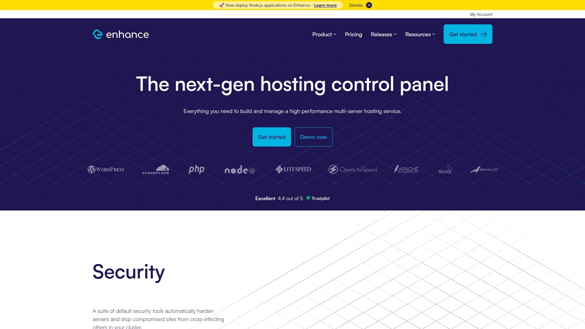

- Multi-server clustering with comprehensive reseller management functionality
- **Why Choose This:** Enhance serves hosting companies requiring robust multi-server management with built-in reseller tools, suitable for providers scaling infrastructure across multiple servers with white-label capabilities.

## **[AdminBolt](https://adminbolt.com)**

Linux hosting control panel for hosting providers, resellers and VPS owners that installs with one command on AlmaLinux 9 or Rocky Linux 9 and manages websites, email, DNS, SSL certificates, databases, backups and security from separate administrator, reseller and client interfaces.

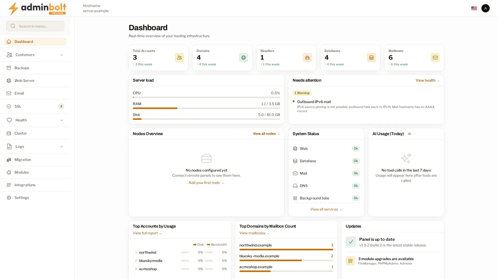

- Apache, LiteSpeed Enterprise and OpenLiteSpeed web servers, a PHP version chosen per domain with PHP-FPM, and Let's Encrypt certificates issued and renewed automatically
- Mail on Postfix, Dovecot and Rspamd with Roundcube webmail, and a DNS zone editor with BIND zone import and export, Cloudflare zone management and DNS clustering across AdminBolt servers
- Per-account backups that clients can restore themselves, two-factor authentication and passkeys for every role, ModSecurity with the OWASP Core Rule Set, Fail2Ban and a panel-wide audit log
- Migration from cPanel and DirectAdmin servers, WHMCS, Blesta and Upmind billing modules, a REST API, and an MCP server for AI assistants; a guided installer converts the server to CloudLinux 9 when you add a CloudLinux licence
- **Why Choose This:** AdminBolt is licensed per server at a flat monthly price with no per-account fees ($20 for a virtual machine, $45 for a bare-metal server), so licence costs stay the same as the number of hosted accounts grows. Its migration tools for cPanel and DirectAdmin and its WHMCS, Blesta and Upmind modules suit hosting providers who want to move existing customers to a new panel and keep their billing platform.

## **[SpinupWP](https://spinupwp.com)**

WordPress-focused server control panel providing optimized configurations and automated management specifically for WordPress hosting environments.

- WordPress-specific optimizations with automated WordPress site management features
- **Why Choose This:** SpinupWP specializes exclusively in WordPress hosting optimization, perfect for agencies and managed WordPress providers requiring specialized configurations and WordPress-specific automation beyond general-purpose control panels.

## **[GridPane](https://gridpane.com)**

High-performance WordPress hosting management platform with advanced caching, security features, and multi-server orchestration for agencies.

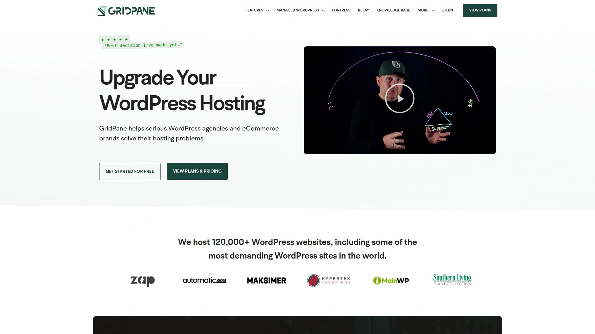

- Advanced WordPress caching and security with multi-server orchestration capabilities
- **Why Choose This:** GridPane delivers enterprise-grade WordPress hosting management with advanced performance optimizations, targeting agencies and managed WordPress hosts requiring sophisticated caching strategies and security hardening across server fleets.

## **[Ploi](https://ploi.io)**

Modern server management panel supporting Laravel and PHP applications with zero-downtime deployment and automated SSL.

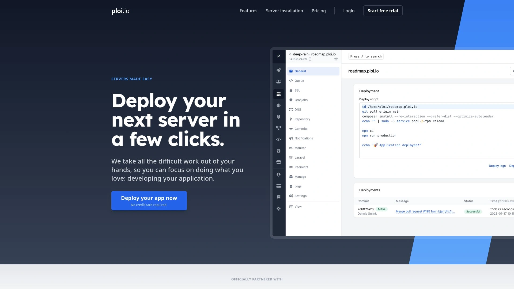

- Laravel and PHP application focus with zero-downtime deployment capabilities
- **Why Choose This:** Ploi specializes in Laravel and modern PHP framework hosting with developer-friendly deployment workflows, ideal for development teams building Laravel applications requiring streamlined deployment and server management.

## **[ServerAvatar](https://serveravatar.com)**

Cloud server management platform simplifying application deployment on popular cloud providers with intuitive interface.

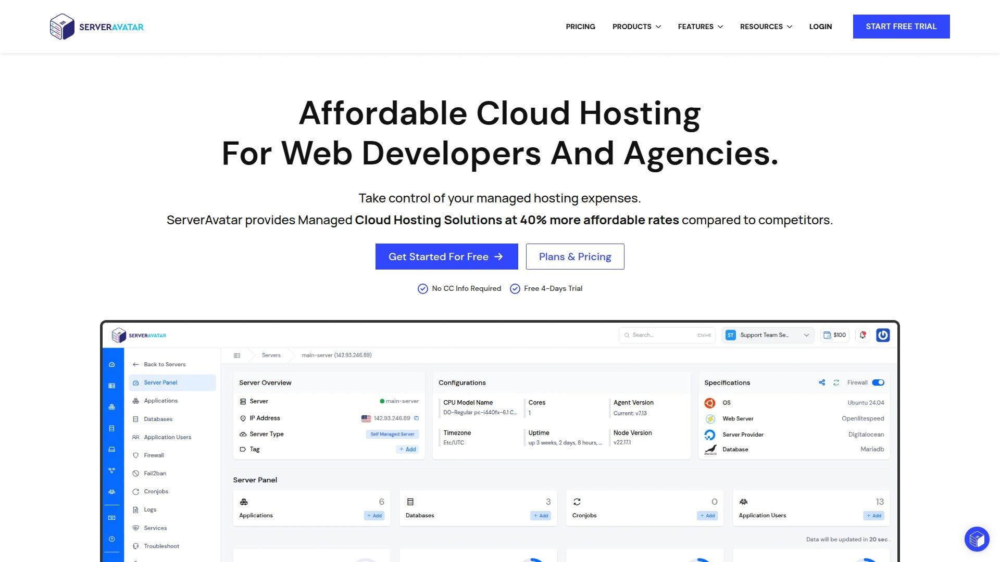

- Simplified cloud application deployment with intuitive management interface
- **Why Choose This:** ServerAvatar abstracts cloud infrastructure complexity while maintaining flexibility, suitable for users requiring cloud hosting benefits without deep DevOps expertise.

## **[Cleavr](https://cleavr.io)**

Server provisioning and deployment platform supporting multiple frameworks with automated workflows and team collaboration features.

- Multi-framework support with automated provisioning and team collaboration tools
- **Why Choose This:** Cleavr enables team-based server and application management with comprehensive framework support, perfect for development agencies managing diverse technology stacks across team members.

## **[Forge (Laravel Forge)](https://forge.laravel.com)**

Server provisioning platform by Laravel creator focusing on PHP application deployment with automated server management.

- Laravel ecosystem integration with PHP-focused automated server provisioning
- **Why Choose This:** Laravel Forge provides seamless Laravel deployment backed by framework creator expertise, essential for Laravel developers seeking officially-supported server management with tight ecosystem integration.

## **[Moss (ServerPilot Alternative)](https://getmoss.com)**

Control panel emphasizing simplicity for PHP application hosting with automated security and performance optimizations.

- PHP application focus with automated security updates and performance tuning
- **Why Choose This:** Moss simplifies PHP application hosting with hands-off security maintenance, suitable for developers prioritizing automated security patching over granular server configuration control.

## **[InterWorx](https://www.interworx.com)**

Web hosting control panel providing NodeWorx for server administration and SiteWorx for individual website management with clustering support.

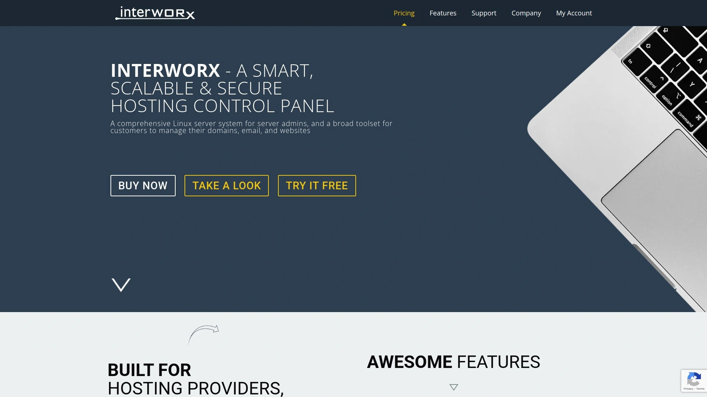

- Dual-interface architecture with NodeWorx for servers and SiteWorx for sites
- **Why Choose This:** InterWorx delivers enterprise-level hosting management with clear separation between server and site administration, suitable for hosting providers requiring granular permission models and clustering capabilities.

## **[CentminMod](https://centminmod.com)**

LEMP stack automation toolset for CentOS providing optimized Nginx, MariaDB, and PHP configurations without traditional GUI.

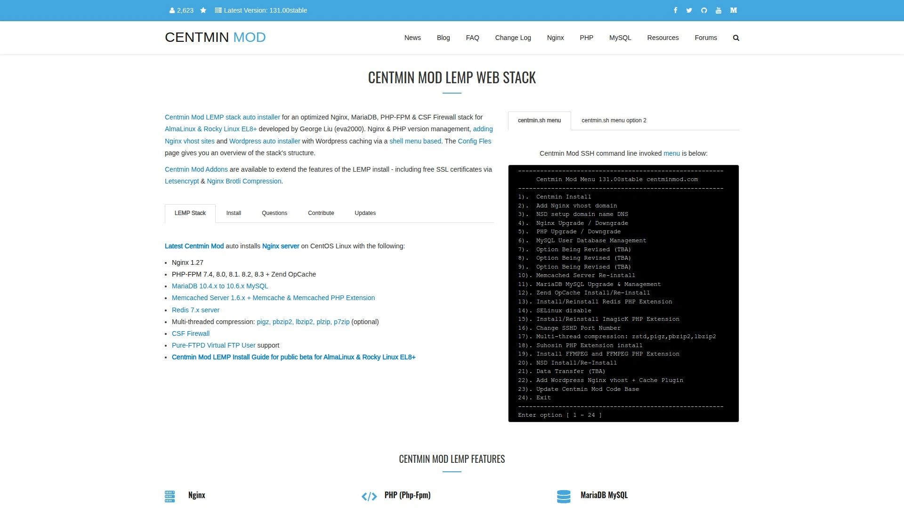

- LEMP stack optimization with automated configuration tuning for performance
- **Why Choose This:** CentminMod appeals to performance-focused administrators comfortable with command-line tools seeking highly-optimized LEMP stack configurations without graphical interface overhead.

## **[EasyEngine](https://easyengine.io)**

Command-line tool for managing WordPress and PHP applications on Nginx with automated site creation and performance optimization.

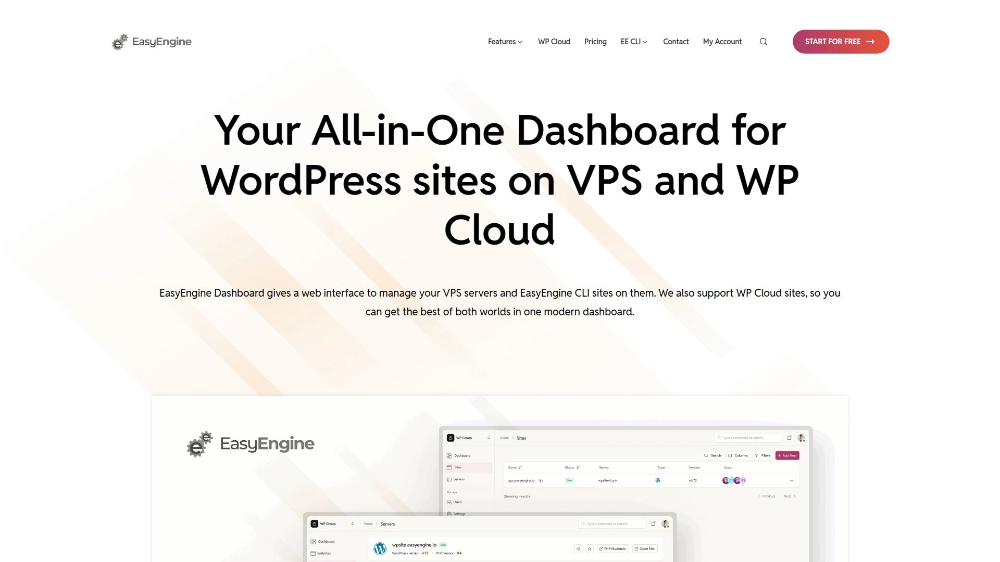

- WordPress and PHP application management via command-line with Nginx optimization
- **Why Choose This:** EasyEngine serves command-line-proficient administrators managing WordPress sites requiring Nginx performance benefits with automation scripts rather than GUI-based management.

## **[Caprover](https://caprover.com)**

Free automated platform-as-a-service (PaaS) solution enabling one-click app deployments with Docker containerization.

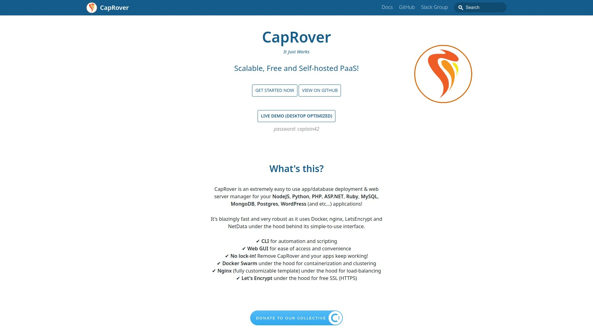

- Docker-based PaaS with one-click application deployment capabilities
- **Why Choose This:** Caprover delivers Heroku-like deployment experience on self-hosted infrastructure using Docker, perfect for developers seeking PaaS convenience without third-party platform dependencies or recurring costs.

## **[YunoHost](https://yunohost.org)**

Debian-based distribution simplifying server administration with focus on self-hosting applications and personal cloud services.

- Personal cloud and self-hosting focus with simplified Debian-based administration
- **Why Choose This:** YunoHost democratizes self-hosting for non-technical users with comprehensive application catalog, ideal for privacy-conscious individuals seeking to host personal services without deep Linux expertise.

## **[Cockpit](https://cockpit-project.org)**

Web-based graphical interface for Linux servers providing system monitoring, service management, and basic administrative tasks.

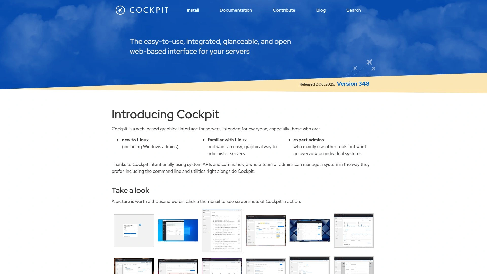

- Lightweight system monitoring and administration with web-based graphical interface
- **Why Choose This:** Cockpit provides system-level administration without hosting-specific features, suitable for general Linux server management where traditional hosting control panel features are unnecessary.

## **[Webmin/Virtualmin GPL](https://www.virtualmin.com)**

Combined open-source solution with Webmin for system administration and Virtualmin GPL for website hosting management without licensing costs.

- Comprehensive system administration with integrated hosting-specific features in free GPL version
- **Why Choose This:** The Webmin/Virtualmin GPL combination delivers professional hosting capabilities completely free, ideal for budget-conscious hosting providers and administrators requiring comprehensive features without premium licensing while maintaining active community support.

## **[ISPmanager](https://www.ispmanager.com)**

Russian-developed control panel offering comprehensive hosting management with focus on Eastern European and Russian markets.

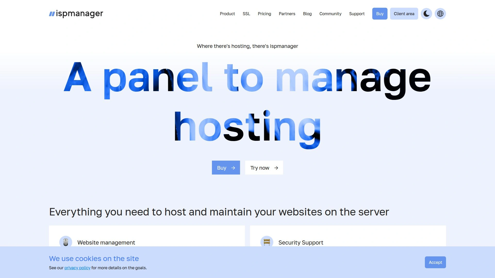

- Comprehensive hosting management with regional focus on Russian and Eastern European markets
- **Why Choose This:** ISPmanager serves hosting providers in Russian-speaking regions with localized support and features tailored to regional hosting requirements and regulatory compliance needs.

## **[Centmin Mod LEMP](https://centminmod.com)**

Advanced LEMP stack installer and optimizer for CentOS providing automated Nginx, MariaDB, and PHP configuration with performance tuning scripts.

- Advanced LEMP stack optimization with automated performance tuning configurations
- **Why Choose This:** Centmin Mod LEMP targets performance-obsessed administrators seeking maximum optimization from Nginx-based stacks, providing comprehensive tuning scripts and configurations for high-traffic environments prioritizing speed over GUI convenience.

## Comparison Table

| Control Panel | License Type | Primary Advantage | Best For | OS Support |
|---|---|---|---|---|
| **Plesk** | Commercial | Multi-server + Windows/Linux support | Enterprise hosting providers | Windows, Linux |
| **cPanel** | Commercial | Industry standard with 400+ apps | Shared hosting, resellers | Linux |
| **DirectAdmin** | Commercial | Speed + cost-effectiveness | Budget-conscious VPS users | Linux, BSD |
| **Webmin** | Open Source | Free with 110+ modules | Unix system administrators | Unix-like systems |
| **CyberPanel** | Open Source | LiteSpeed performance + free | Performance-focused users | Linux |
| **ISPConfig** | Open Source | Multi-server management | Hosting providers scaling | Linux |
| **Virtualmin** | Dual License | GPL free + Professional upgrade | Flexible budget options | Linux |

## FAQ

### What's the difference between commercial and open-source control panels?

Commercial control panels like cPanel, Plesk, and DirectAdmin require licensing fees but offer professional support, comprehensive documentation, and guaranteed updates. Open-source alternatives like Webmin, ISPConfig, and CyberPanel provide zero-cost licensing with community support, though they may require more technical expertise for troubleshooting. Commercial panels typically include automated backup systems, advanced security features, and one-click installations, while open-source options offer customization freedom and no vendor lock-in, making the choice dependent on budget, technical skill level, and support requirements.

### Which control panel offers the best performance for high-traffic websites?

CyberPanel delivers superior performance through integrated LiteSpeed Web Server and LiteSpeed Cache, providing up to 10x speed improvements over traditional Apache-based solutions. Plesk with NGINX caching and DirectAdmin's optimized architecture also excel in high-traffic scenarios. For maximum performance, consider control panels supporting modern caching technologies, HTTP/3 protocol, and efficient resource management—CyberPanel's combination of LiteSpeed technology with free licensing makes it particularly compelling for performance-critical applications without budget constraints.

### Can I migrate between different control panels?

Most major control panels provide migration tools, with Virtualmin offering built-in migration capabilities from Plesk, cPanel, and DirectAdmin. Migration complexity varies depending on source and destination platforms—same-tier migrations (commercial-to-commercial or open-source-to-open-source) typically prove smoother than cross-tier transfers. Manual migration requires transferring website files, databases, email accounts, and DNS configurations, which experienced administrators can accomplish using backup/restore tools and FTP. Always perform full backups before migration attempts, test thoroughly on staging environments, and expect DNS propagation delays of 24-48 hours when changing nameservers.

## Conclusion

Selecting the right web hosting control panel transforms server administration from complex command-line management into streamlined, GUI-based workflows that enhance productivity and reduce errors. **[Plesk](https://www.plesk.com)** leads with its comprehensive Windows and Linux support, multi-server management capabilities, and robust WordPress Toolkit integration—making it the premium choice for hosting providers, resellers, and enterprises requiring versatile automation with enterprise-grade security features. Whether prioritizing commercial reliability with cPanel, cost-effectiveness with DirectAdmin, open-source flexibility with Webmin, or performance excellence with CyberPanel, the control panel landscape offers solutions matching every technical requirement, budget constraint, and scaling ambition. **Streamline your server management today with Plesk's proven platform trusted by web professionals worldwide.**
